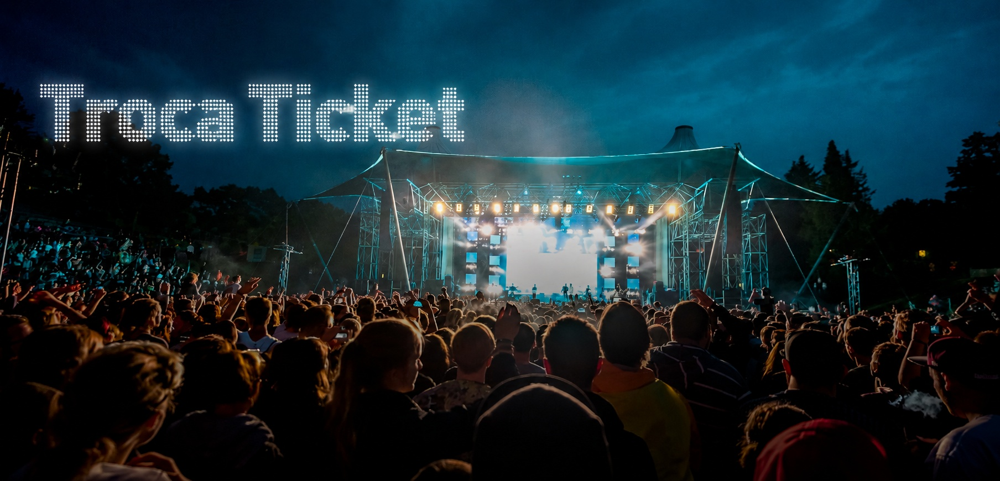

# FECAP - Fundação de Comércio Álvares Penteado


<p align="center">
<a href= "https://www.fecap.br/"></a>
</p>

# TrocaTicket

## Grupo Nexus

## Integrantes: 
<a href="https://www.linkedin.com/in/victorbarq/">Enzo Augusto Pedroza Gonçalves</a>

<a href="https://www.linkedin.com/in/victorbarq/">Felipe Câmara Noguchi</a>

<a href="https://www.linkedin.com/in/leonardo-fran%C3%A7a-68bb97349/">Leonardo Batista França</a>

<a href="https://www.linkedin.com/in/victorbarq/">Stefany Anne Apaza de Freitas</a>

## Professores Orientadores: 
<a href="https://www.linkedin.com/in/dolemes/">David de Oliveira Lemes</a>

<a href="https://www.linkedin.com/in/francisco-escobar/">Francisco de Souza Escobar</a>

<a href="https://www.linkedin.com/in/katia-bossi/">Kátia Bossi</a>

<a href="https://www.linkedin.com/in/cristina-machado-corr%C3%AAa-leite-630309160/">Cristina Machado Corrêa Leite </a>

<a href="https://www.linkedin.com/in/jesuslisboagomes/">Jésus Gomes</a>

## Descrição

<p align="center">
  
</p>
  Game by <a href="http://www.nyphotographic.com/">Nick Youngson</a> <a rel="license" href="https://creativecommons.org/licenses/by-sa/3.0/">CC BY-SA 3.0</a> <a href="http://pix4free.org/">Pix4free</a>
</p>


O TrocaTicket é uma plataforma voltada para o planejamento e organização de eventos, conectando organizadores e fornecedores em um mesmo ambiente. A plataforma permite que organizadores criem seus eventos, cadastrem os custos necessários e publiquem os itens para cotação.

Os fornecedores aprovados podem visualizar os eventos disponíveis e enviar propostas para os itens de custo. A partir das propostas recebidas, o organizador pode comparar as opções, selecionar as propostas e consolidar os custos do evento. Com essas informações, a plataforma também permite calcular o ticket estimado de acordo com o custo total, público e margem de lucro.
<br><br>

## 🛠 Estrutura de pastas

```
Projeto5/
├── Documentos/                          # Entregas do PI, separadas por entrega e disciplina
│   ├── Entrega 1/
│   │   ├── Cálculo II/
│   │   ├── Desenvolvimento Web Full-Stack/
│   │   ├── Gestão Empresarial e Dinâmica das Organizações/
│   │   ├── Projeto em Banco de Dados/
│   │   └── Projeto Interdisciplinar/
│   └── Entrega 2/                       # Mesmas disciplinas da Entrega 1
├── imagens/                             # Imagens e logotipos do TrocaTicket
├── src/
│   └── frontend/                        # Front-end em React + Vite
│       ├── public/
│       └── src/
│           ├── assets/
│           ├── components/
│           ├── context/
│           ├── pages/
│           └── services/
└── README.md
```

<b>Documentos</b>: toda a documentação das entregas, organizada por disciplina.

<b>imagens</b>: imagens do sistema.

<b>src</b>: código-fonte do projeto.

## 💻 Configuração para Desenvolvimento

Para rodar este projeto você precisa do <a href="https://nodejs.org/">Node.js</a> instalado.

```sh
cd src/frontend
npm install
npm run dev
```

Outros comandos disponíveis em `src/frontend`:

```sh
npm run build    # gera a versão de produção em dist/
npm run lint     # verifica o código com o oxlint
```

## 📋 Licença/License
Utilize o link <https://chooser-beta.creativecommons.org/> para fazer uma licença CC BY 4.0.

## 🎓 Referências

Aqui estão as referências usadas no projeto.

1. <https://github.com/iuricode/readme-template>
2. <https://github.com/gabrieldejesus/readme-model>
3. <https://chooser-beta.creativecommons.org/>
4. <https://freesound.org/>
5. <https://www.toptal.com/developers/gitignore>
6. Músicas por: <a href="https://freesound.org/people/DaveJf/sounds/616544/"> DaveJf </a> e <a href="https://freesound.org/people/DRFX/sounds/338986/"> DRFX </a> ambas com Licença CC 0.
