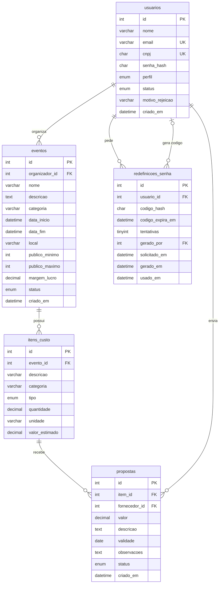

# TrocaTicket — Banco de dados

Banco relacional em **MySQL 8.0.16 ou mais novo**, com tabelas InnoDB e caracteres `utf8mb4`. Ele guarda os usuários da plataforma, os eventos, os itens de custo de cada evento, as propostas dos fornecedores e os pedidos de redefinição de senha.

| Arquivo | Para que serve |
|---|---|
| [`schema.sql`](schema.sql) | Cria o banco `trocaticket`, as tabelas, as chaves e os índices |
| [`seed.sql`](seed.sql) | Insere os dados de exemplo |
| [`setup.js`](setup.js) | Roda os dois scripts acima (`npm run db:criar` e `npm run db:recriar`) |
| [`migracoes/`](migracoes) | Alterações para bancos criados antes de uma mudança no schema |
| [`migrar.js`](migrar.js) | Aplica uma migração sem apagar dados (`npm run db:migrar -- arquivo.sql`) |

As instruções de execução estão no [README da API](../README.md#3-criar-o-banco-de-dados).

## Diagrama

Cardinalidades:

- Um usuário organizador cria zero ou mais eventos, e cada evento tem um único organizador.
- Um evento tem zero ou mais itens de custo, e cada item pertence a um único evento.
- Um item recebe zero ou mais propostas, e cada proposta é para um único item.
- Um usuário fornecedor envia zero ou mais propostas, e cada proposta é de um único fornecedor.
- Um usuário faz zero ou mais pedidos de redefinição de senha, e cada pedido é de um único usuário.
- Um administrador gera códigos para zero ou mais pedidos, e cada pedido tem no máximo um administrador.

## Tabelas

Todos os `id` e chaves estrangeiras são `INT UNSIGNED`.

### `usuarios`

Administradores, organizadores e fornecedores, diferenciados pelo campo `perfil`.

| Campo | Tipo | Nulo | Padrão | Descrição |
|---|---|---|---|---|
| `id` | `INT UNSIGNED` | não | auto incremento | Chave primária |
| `nome` | `VARCHAR(120)` | não | | Nome do usuário ou da empresa |
| `email` | `VARCHAR(160)` | não | | Login, único no sistema |
| `cnpj` | `CHAR(14)` | sim | | CNPJ da empresa, só os 14 dígitos e único. Obrigatório no cadastro (a API valida os dígitos verificadores); o admin fica sem |
| `senha_hash` | `CHAR(60)` | não | | Hash bcrypt da senha, nunca a senha em texto puro |
| `perfil` | `ENUM('admin', 'organizador', 'fornecedor')` | não | | Define o que o usuário pode fazer |
| `status` | `ENUM('pendente', 'aprovado', 'rejeitado')` | não | `pendente` | Situação do cadastro |
| `motivo_rejeicao` | `VARCHAR(500)` | sim | | Obrigatório só quando o status é `rejeitado` |
| `criado_em` | `DATETIME` | não | data atual | Data do cadastro |

### `eventos`

Eventos criados pelos organizadores. Cada evento tem um único tipo de ingresso.

| Campo | Tipo | Nulo | Padrão | Descrição |
|---|---|---|---|---|
| `id` | `INT UNSIGNED` | não | auto incremento | Chave primária |
| `organizador_id` | `INT UNSIGNED` | não | | Chave estrangeira para `usuarios` |
| `nome` | `VARCHAR(150)` | não | | Nome do evento |
| `descricao` | `TEXT` | sim | | Descrição livre |
| `categoria` | `VARCHAR(40)` | sim | | Tipo de evento, como `Corporativo` |
| `data_inicio` | `DATETIME` | não | | Início do evento |
| `data_fim` | `DATETIME` | não | | Fim do evento |
| `local` | `VARCHAR(200)` | não | | Local de realização |
| `publico_minimo` | `INT UNSIGNED` | não | | Cenário de menor público |
| `publico_maximo` | `INT UNSIGNED` | não | | Cenário de maior público |
| `margem_lucro` | `DECIMAL(4, 2)` | não | `0.00` | Fração sobre a receita: `0.25` = 25% |
| `status` | `ENUM('rascunho', 'aguardando_data', 'em_andamento', 'concluido', 'cancelado')` | não | `rascunho` | `em_andamento` é o evento aberto para propostas |
| `criado_em` | `DATETIME` | não | data atual | Data do cadastro |

### `itens_custo`

Composição de custos de cada evento.

| Campo | Tipo | Nulo | Padrão | Descrição |
|---|---|---|---|---|
| `id` | `INT UNSIGNED` | não | auto incremento | Chave primária |
| `evento_id` | `INT UNSIGNED` | não | | Chave estrangeira para `eventos` |
| `descricao` | `VARCHAR(200)` | não | | O que precisa ser contratado ou pago |
| `categoria` | `VARCHAR(80)` | não | | Categoria do item, como `Buffet & Gastronomia` |
| `tipo` | `ENUM('fornecedor', 'fiscal', 'operacional', 'variavel')` | não | | Só itens `fornecedor` recebem propostas |
| `quantidade` | `DECIMAL(10, 2)` | não | `1` | Quantidade do item |
| `unidade` | `VARCHAR(30)` | não | `unidade` | Unidade da quantidade, como `pessoas` |
| `valor_estimado` | `DECIMAL(12, 2)` | não | `0.00` | Custo total estimado do item, já considerando a quantidade |

### `propostas`

Cada linha é a proposta de um fornecedor para um item de custo.

| Campo | Tipo | Nulo | Padrão | Descrição |
|---|---|---|---|---|
| `id` | `INT UNSIGNED` | não | auto incremento | Chave primária |
| `item_id` | `INT UNSIGNED` | não | | Chave estrangeira para `itens_custo` |
| `fornecedor_id` | `INT UNSIGNED` | não | | Chave estrangeira para `usuarios` |
| `valor` | `DECIMAL(12, 2)` | não | | Valor total ofertado para o item |
| `descricao` | `TEXT` | não | | O que a proposta inclui |
| `validade` | `DATE` | não | | Data até quando a proposta vale |
| `observacoes` | `TEXT` | sim | | Condições adicionais |
| `status` | `ENUM('em_analise', 'selecionada', 'recusada')` | não | `em_analise` | Situação da proposta |
| `criado_em` | `DATETIME` | não | data atual | Data do envio |

### `redefinicoes_senha`

Pedidos de redefinição de senha. O usuário pede, o administrador gera um código e o usuário o usa para criar a senha nova. Ficam guardados como registro de quem pediu e de quem autorizou.

| Campo | Tipo | Nulo | Padrão | Descrição |
|---|---|---|---|---|
| `id` | `INT UNSIGNED` | não | auto incremento | Chave primária |
| `usuario_id` | `INT UNSIGNED` | não | | Chave estrangeira para `usuarios`: quem pediu |
| `codigo_hash` | `CHAR(60)` | sim | | Hash bcrypt do código, nunca o código em texto puro |
| `codigo_expira_em` | `DATETIME` | sim | | Até quando o código vale |
| `tentativas` | `TINYINT UNSIGNED` | não | `0` | Códigos errados informados |
| `gerado_por` | `INT UNSIGNED` | sim | | Chave estrangeira para `usuarios`: administrador que gerou o código |
| `solicitado_em` | `DATETIME` | não | data atual | Data do pedido |
| `gerado_em` | `DATETIME` | sim | | Data em que o código foi gerado |
| `usado_em` | `DATETIME` | sim | | Data em que a senha foi trocada |

## Chaves estrangeiras

| Tabela | Campo | Referência | Ao apagar | Ao atualizar |
|---|---|---|---|---|
| `eventos` | `organizador_id` | `usuarios.id` | `RESTRICT` | `CASCADE` |
| `itens_custo` | `evento_id` | `eventos.id` | `CASCADE` | `CASCADE` |
| `propostas` | `item_id` | `itens_custo.id` | `CASCADE` | `CASCADE` |
| `propostas` | `fornecedor_id` | `usuarios.id` | `RESTRICT` | `CASCADE` |
| `redefinicoes_senha` | `usuario_id` | `usuarios.id` | `CASCADE` | `CASCADE` |
| `redefinicoes_senha` | `gerado_por` | `usuarios.id` | `SET NULL` | `CASCADE` |

Na prática, apagar um evento apaga os itens e as propostas dele, e não é possível apagar um usuário que tenha eventos ou propostas. Assim, nenhum registro fica órfão.

## Regras de integridade

| Tabela | Regra | Restrição |
|---|---|---|
| `usuarios` | E-mail único | `uq_usuarios_email` |
| `usuarios` | Nome não pode ficar vazio | `ck_usuarios_nome` |
| `usuarios` | Motivo só existe, e é obrigatório, em cadastro rejeitado | `ck_usuarios_motivo` |
| `eventos` | Nome não pode ficar vazio | `ck_eventos_nome` |
| `eventos` | Fim não pode ser antes do início | `ck_eventos_datas` |
| `eventos` | Público mínimo maior que zero e máximo não menor que o mínimo | `ck_eventos_publico` |
| `eventos` | Margem entre 0 e 0,99, para o cálculo do ticket nunca dividir por zero | `ck_eventos_margem` |
| `itens_custo` | Descrição não pode ficar vazia | `ck_itens_custo_descricao` |
| `itens_custo` | Quantidade maior que zero | `ck_itens_custo_quantidade` |
| `itens_custo` | Valor estimado não pode ser negativo | `ck_itens_custo_valor` |
| `propostas` | Uma proposta por fornecedor para cada item | `uq_propostas_item_fornecedor` |
| `propostas` | Valor maior que zero | `ck_propostas_valor` |

Estas regras dependem de outras tabelas ou do fluxo e ficam na API:

- Só o organizador dono altera o evento.
- Só usuários com perfil `fornecedor` e aprovados enviam propostas.
- Só eventos `em_andamento` recebem propostas, e só em itens do tipo `fornecedor`.
- Cada item tem no máximo uma proposta `selecionada`.

## Índices

Além das chaves primárias e únicas:

| Índice | Tabela | Campo | Uso |
|---|---|---|---|
| `idx_eventos_organizador` | `eventos` | `organizador_id` | Eventos de um organizador |
| `idx_eventos_status` | `eventos` | `status` | Eventos abertos para cotação |
| `idx_itens_custo_evento` | `itens_custo` | `evento_id` | Itens de um evento |
| `idx_propostas_fornecedor` | `propostas` | `fornecedor_id` | Propostas de um fornecedor |
| `idx_propostas_status` | `propostas` | `status` | Propostas por situação |
| `idx_redefinicoes_usado` | `redefinicoes_senha` | `usado_em` | Pedidos ainda em aberto |

## Dados de exemplo

O `seed.sql` insere 7 usuários (com cadastros aprovados, pendentes e rejeitados), 3 eventos, 9 itens de custo e 5 propostas. As contas de teste estão no [README da API](../README.md#credenciais-de-teste).

## Diferenças em relação à modelagem da Entrega 1

O [modelo conceitual](../../../Documentos/Entrega%201/Projeto%20em%20Banco%20de%20Dados/Der_TrocaTicket.pdf) e o [modelo lógico](../../../Documentos/Entrega%201/Projeto%20em%20Banco%20de%20Dados/Der_ModeloLogico.pdf) representam a solução completa. A implementação cobre as entidades essenciais do MVP, e este documento descreve o que existe no banco hoje.

| Na modelagem | Na implementação |
|---|---|
| `Usuario` especializado em `Organizador`, `Fornecedor` e `Administrador` | Uma tabela `usuarios` com o campo `perfil`. O CNPJ já é pedido no cadastro (coluna `cnpj`); telefone e razão social ainda não foram implementados |
| `Categoria` e `Atua_em` | `categoria` é um campo de texto em `eventos` e `itens_custo`, e a área de atuação do fornecedor ainda não é registrada |
| `Item_custo` e `Custo` separados | Uma tabela `itens_custo` com o campo `tipo`, que diferencia custos de fornecedor, fiscais, operacionais e variáveis |
| `Simulacao` | Não é gravada: o ticket é calculado a partir dos dados do evento sempre que a tela é aberta |
| `Avalia` | Não implementada: avaliação de fornecedores é uma extensão opcional do projeto |
| `Proposta` com chave composta | `propostas` tem `id` próprio e mantém a regra com a chave única (`item_id`, `fornecedor_id`) |
| `Evento` com `Cidade`, `UF` e `Publico_esperado` | Cidade e UF ficam no campo `local`, e o público esperado, que é opcional no enunciado, não foi implementado |
